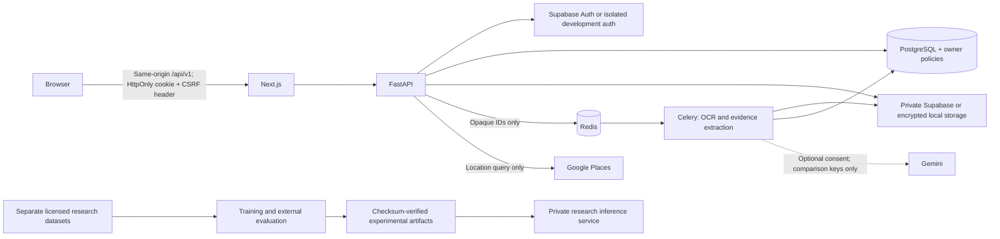

# Architecture and data boundaries

MediCare AI is a Next.js App Router frontend and a FastAPI REST API. PostgreSQL is the source of truth. Redis brokers Celery jobs. Tesseract and PyMuPDF extract source text. OpenCV supplies acquisition-quality checks, not medical confidence. An independent PyTorch/MONAI/Transformers environment supports research.

## Ownership and sessions

Every patient-resource query includes the authenticated UUID. Sensitive tables also enable and force PostgreSQL owner policies, using transaction-local `app.user_id`. Supabase browser roles have their application-table permissions revoked. Production must use a non-superuser, `NOBYPASSRLS` application login. The migration/retention identities are separately controlled. Tests independently exercise API isolation and a real non-superuser PostgreSQL role.

Local authentication is a development-only Argon2id + expiring JWT implementation. Tokens are HttpOnly, SameSite cookies; production cookies are Secure. Unsafe operations require a matching CSRF token and reject foreign origins. Signing out increments the local account session version, invalidating existing local sessions. Supabase sessions are validated with its Auth service and refreshed using an HttpOnly refresh cookie. Session tokens are never placed in browser storage.

## Processing states

`uploaded → queued → processing → completed | failed`. The worker locks the report during processing and stores source quotations alongside measurements. Unsupported data yields no invented measurement. Missing units are not inferred. Reference comparisons use only a range printed on the same source line. Reanalysis can be requested for a completed/failed report. Queue failure preserves the upload and records a retryable error. Soft timeouts produce a failed state. Monitor jobs stuck in queued state after infrastructure outages.

The prescription parser matches only names from sourced catalog records, copies other fields from literal source text, and marks candidates unconfirmed. An empty catalog or illegible OCR means no candidate; the user must verify entries with a clinician/pharmacist. Confirmation never authorizes a medicine.

## What does not cross a boundary

- No real-patient uploads belong in the local development workspace.
- No record is fed into the research dataset or model-training pipeline.
- No original document, name, report text, or numeric measurement is sent to Gemini. The optional adapter accepts only a verified selection from approved comparison-template keys; it cannot introduce free-text findings.
- Research inference is disconnected from patient-facing analysis and rejects production mode. No weights are bundled.
- Google Places responses are never evidence of medicine stock. Inventory requires an administrator-verified source and expires within 24 hours.
- No synthetic medicine catalog, prices, locations, or medical predictions are seeded.

## Monorepo

`apps/web`: pages, client API wrapper, accessible form primitives, dictionaries, responsive styles. `services/api`: schemas, models, migrations, auth, storage, OCR, queue, catalog. `services/worker`: operating instructions for the shared worker. `services/inference`: private research service. `ml`: dataset preparation, training, calibration, subgroup metrics, external evaluation. `packages/shared-types`: OpenAPI-generated TypeScript contract. `packages/ui`: design-system documentation. `infrastructure`: container and deployment assets. `tests`: browser and research engineering checks.
